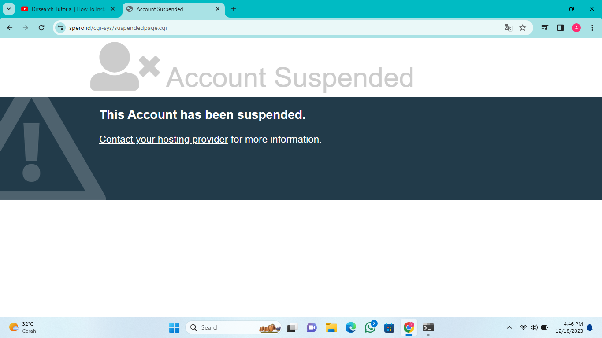
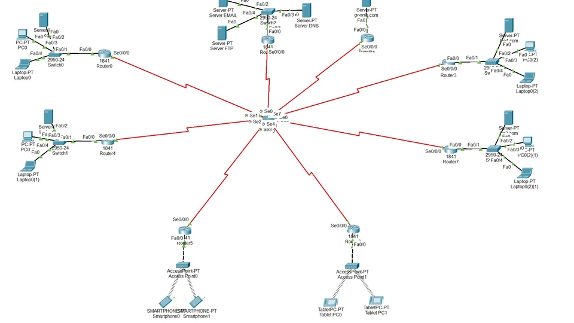
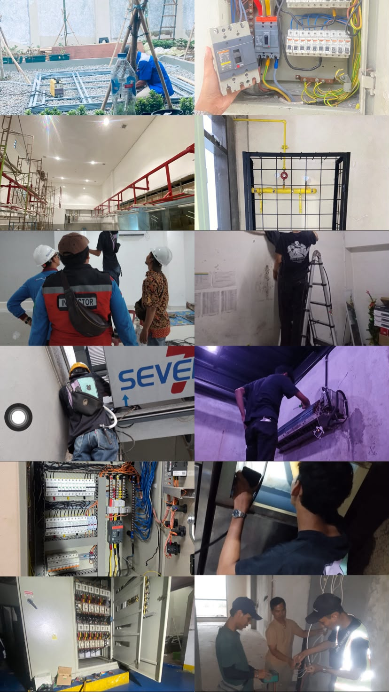

<html lang="id">
<head>
  <meta charset="UTF-8">
  <meta name="viewport" content="width=device-width, initial-scale=1.0">
  <meta name="description" content="Portofolio Syaly Darma Prayoga di bidang teknologi informasi, cyber security, networking, dan teknik.">
  <meta name="theme-color" content="#0b1220">
  <title>Syaly Darma Prayoga | Portofolio</title>
  <link rel="preconnect" href="https://fonts.googleapis.com">
  <link rel="preconnect" href="https://fonts.gstatic.com" crossorigin>
  <link href="https://fonts.googleapis.com/css2?family=Inter:wght@400;500;600;700;800&display=swap" rel="stylesheet">
  
</head>
<body>
  <header class="site-header">
    <nav class="nav container" aria-label="Navigasi utama">
      <a class="brand" href="#home" aria-label="Syaly Darma Prayoga - beranda">YOGA BUKAN AGOY</a>
      <button class="menu-toggle" type="button" aria-label="Buka navigasi" aria-expanded="false" aria-controls="nav-links">☰</button>
      <ul class="nav-links" id="nav-links">
        <li><a href="#home">Beranda</a></li>
        <li><a href="#about">Tentang</a></li>
        <li><a href="#services">Keahlian</a></li>
        <li><a href="#portfolio">Proyek</a></li>
        <li><a href="#contact">Kontak</a></li>
      </ul>
    </nav>
  </header>

  <main>
    <section class="hero" id="home">
      

        
Portofolio Profesional

        <h1>Halo, saya Syaly Darma Prayoga</h1>
        
IT Enthusiast · Cyber Security · Networking · MEP &amp; Electrical

        
Menggabungkan minat di bidang teknologi informasi dengan pengalaman teknis untuk membantu membangun solusi yang aman, efektif, dan bermanfaat.

        

          <a class="button button-primary" href="#portfolio">Lihat Proyek ↗</a>
          <a class="button button-outline" href="#contact">Hubungi Saya</a>
        

      

    </section>

    <section class="section container about" id="about">
      

        
Kenali Saya

        <h2>Tentang Saya</h2>
        
Saya adalah seorang mahasiswa Teknik Informatika yang memiliki minat pada bidang cyber security dan juga memiliki pengalaman di bidang mechanical electrical dan plumbing yang ingin terus mengembangkan skill dan pengetahuan

      

      

        

          
        

        

          <h3>IT &amp; Technical Enthusiast</h3>
          
Saya memiliki minat pada teknologi informasi, khususnya Cyber Security dan Networking, serta pengalaman praktik di bidang mekanikal, elektrikal, cctv , dan sistem pendingin. Saya senang mempelajari hal baru, menganalisis masalah, dan mencari solusi yang dapat diterapkan secara langsung.

          

            
<small>Nama</small><strong>Syaly Darma Prayoga</strong>

            
<small>Fokus</small><strong>IT &amp; Teknik</strong>

            
<small>Bidang</small><strong>Cyber Security &amp; MEP</strong>

            
<small>Domisili</small><strong>Depok, Jawa Barat</strong>

          

          <a class="button button-primary" href="#contact">Diskusi Proyek</a>
        

      

    </section>

    <section class="section section-muted" id="services">
      

        

          
Bidang yang Ditekuni

          <h2>Keahlian &amp; Minat</h2>
          
Bidang yang terus saya kembangkan melalui pembelajaran dan pengalaman praktik.

        

        

          <article class="skill-card">
            
⌘

            <h3>Cyber Security</h3>
            
Pemahaman dasar keamanan sistem, pengenalan kerentanan, serta pengujian keamanan secara etis pada sistem yang memiliki izin, dan melaporkan hasil pengujian.

          </article>
          <article class="skill-card">
            
⌁

            <h3>Networking &amp; IT</h3>
            
Dasar jaringan komputer, troubleshooting, konfigurasi jaringan, serta pemahaman perangkat dan sistem komputer.

          </article>
          <article class="skill-card">
            
ϟ

            <h3>MEP &amp; Electrical</h3>
            
Pengalaman praktik instalasi dan troubleshooting kelistrikan, mekanikal, plumbing, cctv, serta sistem pendingin.

          </article>
        

      

    </section>

    <section class="section container" id="portfolio">
      

        
Evidence

        <h2>KEAHLIAN SAYA</h2>
        
Beberapa bidang proyek dan praktik yang relevan dengan minat serta pengalaman saya.

      

      

        <button class="filter active" type="button" data-filter="all" aria-pressed="true">Semua</button>
        <button class="filter" type="button" data-filter="security" aria-pressed="false">Cyber Security</button>
        <button class="filter" type="button" data-filter="network" aria-pressed="false">Networking</button>
        <button class="filter" type="button" data-filter="technical" aria-pressed="false">Teknik</button>
      

      

        <article class="project-card" data-category="security">
          
          

            <small>CYBER SECURITY</small>
            <h3>Penetration Testing</h3>
            
Laporan hasil pengujian, tujuan pengujian, metode, dan temuan keamanan pada website atau aplikasi yang diizinkan.

            <a href="#contact">Tanyakan proyek ↗</a>
          

        </article>
        <article class="project-card" data-category="network">
          
          

            <small>NETWORKING</small>
            <h3>Perancangan Jaringan</h3>
            
Perencanaan topologi jaringan, pembagian alamat IP, konfigurasi perangkat, dan pengujian konektivitas jaringan.

            <a href="#contact">Tanyakan proyek ↗</a>
          

        </article>
        <article class="project-card" data-category="technical">
          
          

            <small>MEP / ELECTRICAL</small>
            <h3>Instalasi & Troubleshooting</h3>
            
Berpengalaman dalam pekerjaan MEP yang mencakup mekanikal, elektrikal, plumbing, cctv. Terbiasa melakukan instalasi, pengecekan, perawatan rutin, dan troubleshooting untuk memastikan peralatan serta sistem tetap berfungsi dengan baik, aman, dan optimal.

            <a href="#contact">Tanyakan proyek ↗</a>
          

        </article>
      

    </section>

    <section class="stats" aria-label="Ringkasan portofolio">
      

        
<strong>IT</strong>Teknologi Informasi

        
<strong>MEP</strong>Pengalaman Teknis

        
<strong>∞</strong>Semangat Belajar

      

    </section>
  <section class="section section-muted" id="contact">
      

        

          
Mari Terhubung

          <h2>Hubungi Saya</h2>
          
Terbuka untuk diskusi, kolaborasi, dan kesempatan kerja yang relevan.

        

        

          
Email<a href="mailto:syalydarmaprayoga19@gmail.com">syalydarmaprayoga19@gmail.com</a>

          
LinkedIn<a href="https://www.linkedin.com/in/drmapryga/" target="_blank" rel="noopener noreferrer">linkedin.com/in/drmapryga</a>

          
Instagram<a href="https://www.instagram.com/drmapryga_/" target="_blank" rel="noopener noreferrer">instagram.com/drmapryga_</a>

          
Domisili<strong>Depok, Jawa Barat, Indonesia</strong>

        

      

    </section>
  </main>

  <footer class="footer">
    

      <a class="brand" href="#home">Thanks Bray Salam Kenal...</a>
      
©  Syaly Darma Prayoga

      <a href="#home">Kembali ke atas ↑</a>
    

  </footer>

  
</body>
</html>
